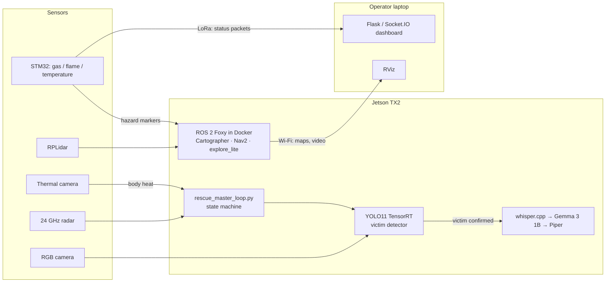

# Offline AI Payload for Search & Rescue Robots

[](https://docs.ros.org/en/foxy/)
[](https://developer.nvidia.com/embedded/jetson-tx2)
[](https://www.st.com/)
[](#staying-connected)

After an earthquake, phone and internet networks often fail within minutes, and cloud-based AI stops working exactly when it is needed. This repository contains a **self-contained payload that turns a ROS 2 ground robot into an offline search-and-rescue platform**: it finds victims, talks to them, watches for hazards and reports back, with every model running locally on an NVIDIA Jetson TX2.

📄 **Project page:** [bajhaw.com/projects/offline-multi-sensor-ai-payload-for-usar](https://bajhaw.com/projects/offline-multi-sensor-ai-payload-for-usar)

---

## Contents

- [What it does](#what-it-does)
- [Key results](#key-results)
- [System architecture](#system-architecture)
- [Hardware](#hardware)
- [Repository structure](#repository-structure)
- [Getting started](#getting-started)
- [Limitations](#limitations)
- [Credits](#credits)

---

## What it does

| Capability | How |
|---|---|
| **Finds victims** | A low-power thermal camera watches continuously and only wakes the heavier visual detector (YOLO11, TensorRT) when it sees body heat. A 24 GHz radar confirms breathing motion. |
| **Talks to them** | An offline voice assistant: whisper.cpp (speech-to-text) → Gemma 3 1B via llama.cpp (reply) → Piper (text-to-speech). |
| **Watches for danger** | An STM32 microcontroller reads gas, flame and temperature sensors on a fixed schedule, independent of the AI workload. Hazards appear as map markers and the robot plans around them. |
| **Maps and explores** | Cartographer 2D SLAM, Nav2 and frontier exploration (`explore_lite`) on an RPLidar. |
| **Reports back** | Wi-Fi carries maps and video when available; a LoRa (SX1278) link carries compact status packets (position, victim status, hazards) when Wi-Fi drops. |

The detector was trained on a lab-collected dataset of people lying down, partly hidden or in dim light, because public datasets mostly show people standing.

## Key results

All figures were measured in the lab on indoor research robots.

| Metric | Result |
|---|---|
| Peak platform power (Jetson TX2) | **< 12 W** (≈ 2 W idle / sensors only, ≈ 7 W with the visual detector running) |
| Voice response latency | **≈ 6.3 s** total: speech-to-text 2.3 s + LLM reply 3.4 s + speech 0.6 s |
| Radar breathing detection, no barrier | 54 / 80 trials (67.5 %), mean range error ≈ 0.16 m, useful range ≈ 6 m |
| Radar breathing detection, 3 cm wood barrier | 39 / 80 trials (48.75 %), mean range error ≈ 0.18 m, useful range ≈ 5 m |
| Robot portability | Same ROS 2 interface on a TurtleBot3 Waffle Pi and a TurtleBot2 Kobuki |

Because of these limits, the radar is used only as a **confirmation sensor** after a visual or audio trigger, never as a stand-alone search tool.

## System architecture



**Operating loop:** thermal scan → wake the detector → confirm a victim → send a LoRa alert → switch to voice mode → return to low-power scanning. The speech and language models do not fit in memory together, so the state machine swaps them as needed.

## Hardware

- **Compute:** NVIDIA Jetson TX2
- **Robot bases:** TurtleBot3 Waffle Pi (main test platform) and TurtleBot2 Kobuki (portability check)
- **Perception:** FLIR Lepton 3 thermal camera, RGB camera, 24 GHz radar module, RPLidar
- **Sensor board:** STM32F411 "BlackPill" with gas, flame, temperature and IMU sensors
- **Radio:** SX1278 LoRa modules (robot and ground station)

## Repository structure

```text
DisasterPlatform/
├── Host_PC/                     # Runs on the operator's laptop
│   ├── dashboard_server.py      # Flask + Socket.IO telemetry dashboard (LoRa / ROS input)
│   ├── dashboard_ui/            # Dashboard web front end
│   ├── host_telemetry.py
│   ├── rviz/nav2_magic.rviz     # RViz layout for maps, paths and markers
│   └── start_all.sh             # Opens the dashboard and launches robot nodes over SSH
├── Jetson/                      # Runs on the robot
│   ├── Dockerfile               # ROS 2 Foxy image with Cartographer
│   ├── configs/                 # SLAM, Nav2 and Fast DDS parameters
│   ├── models/                  # TurtleBot3 Waffle simulation model
│   ├── scripts/                 # AI orchestration
│   │   ├── rescue_master_loop.py      # Master state machine (thermal → vision → voice)
│   │   ├── best_victim_detection.py   # YOLO11 TensorRT victim detector
│   │   ├── talk_gemma_rescue.py       # Offline voice assistant
│   │   ├── cognitive_intervention_node.py
│   │   └── sensor_bridge.py
│   └── ros2_ws/src/
│       ├── disaster_cartographer/     # 2D SLAM configuration and launch files
│       ├── sensor_markers/            # Sensor, hazard, IMU and LoRa ROS 2 nodes
│       ├── m-explore-ros2/            # Frontier exploration (external, see below)
│       └── rplidar_ros/               # RPLidar driver (external, see below)
├── firmware/                    # STM32 firmware (STM32CubeIDE projects)
│   ├── stm32_blackpill_sensors/ # Sensor acquisition + LoRa transmitter
│   ├── stm32_bluepill_lora/     # LoRa link firmware
│   ├── stm32_lora_firmware/
│   └── stm32_lora_hal/
├── docs/                        # Development phase reports and integration notes
└── sync.sh                      # Helper script to commit and push changes
```

## Getting started

> The scripts were written for the development robot and contain absolute paths (e.g. `/home/<user>/...`), a fixed container name (`my_ros2_robot`) and network settings. Adjust these to match your own setup before running.

### 1. Prepare the ROS 2 workspace (Jetson)

`m-explore-ros2` and `rplidar_ros` are referenced as external repositories. Clone them into the workspace before building:

```bash
cd Jetson/ros2_ws/src
git clone https://github.com/robo-friends/m-explore-ros2.git
git clone -b ros2 https://github.com/Slamtec/rplidar_ros.git
```

Build the Docker image and the workspace inside it:

```bash
cd Jetson
docker build -t disaster_platform .
# inside the container
source /opt/ros/foxy/setup.bash
colcon build
```

### 2. One-command launch (from the laptop)

```bash
cd Host_PC
./start_all.sh
```

The script asks for the Jetson's IP address, starts the local dashboard and opens terminal tabs that start the sensor and SLAM nodes on the robot over SSH.

### 3. Manual launch

Inside the robot's Docker container, each in its own terminal (after `source /opt/ros/foxy/setup.bash && source install/setup.bash`):

```bash
# Robot base (Kobuki example)
ros2 run kobuki_node kobuki_ros_node --ros-args -p device_port:=/dev/kobuki \
  -p base_frame:=base_link -p cmd_vel_timeout:=2.0 --remap /commands/velocity:=/cmd_vel

# Mapping, navigation and exploration
ros2 launch disaster_cartographer cartographer.launch.py
./start_nav2.sh
ros2 launch explore_lite explore.launch.py

# Sensor and hazard nodes
ros2 run sensor_markers wired_sensors_node --ros-args -p serial_port:=/dev/ttyACM1
ros2 run sensor_markers cognitive_intervention_node
```

On the Jetson host (outside Docker), start the AI loop:

```bash
python3 Jetson/scripts/rescue_master_loop.py
```

On the laptop, start the monitoring tools:

```bash
ros2 run rviz2 rviz2 -d Host_PC/rviz/nav2_magic.rviz
python3 Host_PC/dashboard_server.py
```

### Development notes

- Make changes to ROS 2 packages in `Jetson/ros2_ws/src/` and rebuild with `colcon build` inside the container.
- Do not commit the generated `build/`, `install/` or `log/` directories.

## Limitations

These are lab results on indoor research robots. The detector was trained on simulated disaster scenes, the radar was only tested in the lab (not in rubble or reinforced concrete) and serves as a confirmation sensor, and the voice assistant needs about six seconds to start replying. Testing in real rubble and on rugged robot platforms is the next step.

## Credits

Developed at the **RAI Laboratory, Department of Mechatronics Engineering, Fırat University**, by Mohammed Bajhaw with Munef El Muhammed, Anas Mahyoub Naji Saeed Alqadhi and Ayşegül Uçar.
